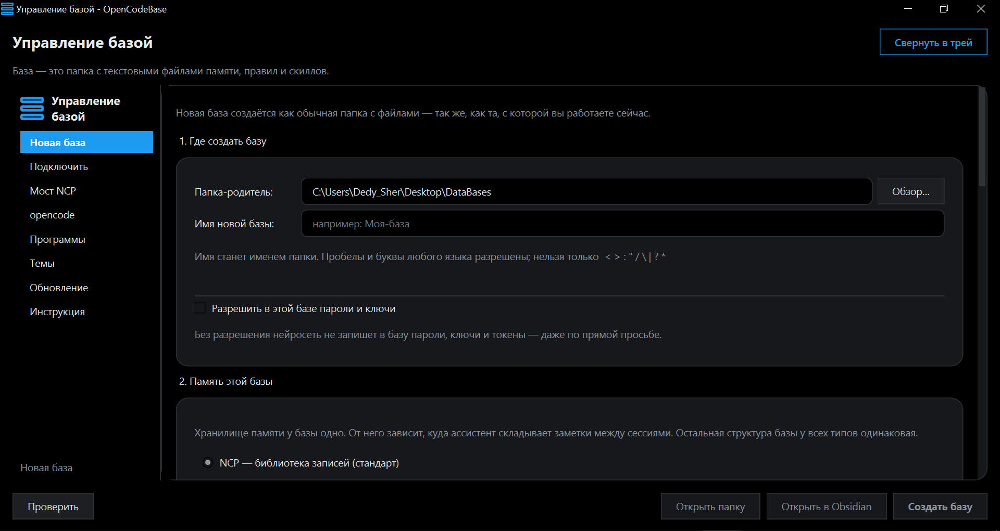
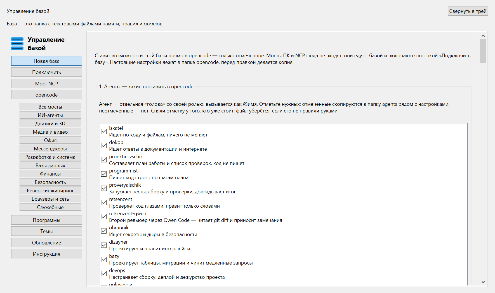

# opencode-base

**Постоянная память для ИИ-ассистента: знания, правила, навыки и мосты к вашим программам — в одном окне.**

`Windows 10/11` · `Python 3 + PyQt6` · `Node.js` · `MIT`



*Окно «Управление базой» в тёмной теме. Слева — восемь вкладок, справа — создание новой базы: папка, имя и выбор памяти.*

---

## Зачем это нужно

ИИ-ассистент забывает всё после сессии. Вы объясняете ему, где лежат ваши
документы, как вы называете папки, какие правила соблюдаете, — а завтра
объясняете заново.

opencode-base решает это: знания, правила и навыки лежат обычными файлами
в одной папке, а ассистент читает их в начале каждой сессии. Плюс к этому —
мосты, через которые он видит OBS, эмулятор, браузер и ещё десяток программ,
и каталог из 55 готовых серверов MCP.

Всё это ставится и подключается из одного окна, без правки конфигов руками.

---

## Возможности и преимущества

### Три типа памяти на выбор

У базы ровно один тип памяти. Он выбирается при создании — блок 2 вкладки
«Новая база», по умолчанию NCP. Сочетать типы нельзя: иначе в базе оказалось
бы два хранилища, и никто не знал бы, куда писать.

| | NCP | Obsidian | Hindsight |
|---|---|---|---|
| Что хранит память | папка `библиотека` с записями | сама база как хранилище заметок | внешний сервер, банк на каждую базу |
| Папок в новой базе | 18 | 11 | 11 |
| Мостов при создании | 2 (NCP и ПК) | 1 (ПК) | 1 (ПК) |
| Что нужно снаружи | ничего, только стандартная библиотека Python | Obsidian, по желанию, для чтения | uv или Docker и ключ LLM |
| Когда подходит | обычная работа с записями и поиском | уже есть хранилище Obsidian | нужен отдельный банк памяти с сервером |

**NCP** — папка `библиотека` с поиском и мост, через который ассистент
спрашивает состояние, находит запись и сохраняет новую. Ничего доустанавливать
не нужно: мост написан на стандартной библиотеке Python.

**Obsidian** — сама база открывается в Obsidian как хранилище заметок.
Папки «библиотека» нет, мост NCP не ставится.

**Hindsight** — внешний банк памяти. Программа сама ставит и поднимает
сервер: через `uv` (отдельный модуль, Docker не нужен) или через `docker`
(официальный образ). Сервер работает на `127.0.0.1:8888`, у каждой базы
свой банк — `/mcp/<банк>/`. Данные лежат во встроенной PostgreSQL
в `~/.hindsight/data/`, отдельно её ставить не нужно. Ключ модели программа
берёт из `opencode.jsonc` и передаёт на лету, в базу он не пишется.
Кнопка не говорит «работает», пока `/health/ready` не ответил: «жив»
и «готов» — разные вещи.

Без сервера память Hindsight не работает, и программа говорит об этом прямо,
а не ставит зелёную отметку на пустом месте.

**Общее для всех типов:** `profile.md`, `facts.md` и `projects.md` в новой
базе остаются пустыми заготовками. Чужие личные данные не копируются —
это правило, а не настройка.

---

### Одиннадцать мостов внутри программы

Мост — маленькая программа, которая даёт ассистенту доступ к чему-то
внешнему: к студии OBS, к эмулятору, к браузеру. У каждого моста есть живая
проверка: кнопка не говорит «работает», пока мост не ответил.

| Мост | Что даёт | Инструментов | Состояние |
|---|---|---|---|
| Android Studio | сборка, ошибки, проверки кода, отладка открытого проекта | — | не проверялся |
| Android-эмулятор (LDPlayer, BlueStacks) | скриншоты, дерево интерфейса, нажатия, команды adb | 5 | проверен |
| DBHub | PostgreSQL, MySQL, MariaDB, SQL Server, Oracle, SQLite одним сервером | 2 | не проверялся |
| Ghidra | дизассемблирование, декомпиляция, скрипты, отладчик | 67 | проверен |
| Godot | сцены, узлы, скрипты в редакторе Godot 4.7+ | — | не проверялся |
| LDPlayer | инстансы: запуск, остановка, копии, проверка приложений | 38 | проверен |
| LMArena | модели Arena провайдером для opencode | 3 | не проверялся |
| OBS Studio | сцены, источники, звук, запись, трансляция | 125 | не проверялся |
| OmniRoute | шлюз к провайдерам моделей (358 провайдеров) | 110 | проверен |
| Unity | сцена, объекты, скрипты C#, ассеты, тесты | — | не проверялся |
| Браузеры (Chrome, Edge, Яндекс, Firefox) | открыть страницу, прочитать, нажать кнопку, свой профиль | 25 | не проверялся |

Прочерк в графе «Инструментов» означает «не считали», а не ноль.
Статус «не проверялся» — это честно: мост есть и настроен, но живым запросом
его не проверяли.

**Мостам нужна живая программа.** OBS, эмулятор, LDPlayer, Android Studio,
Unity, Godot, DaVinci Resolve, Blender — без открытого приложения мост
не ответит, и программа скажет почему.

**Секреты не лежат в конфиге.** Пароль OBS передаётся мосту переменной
окружения, токены лежат в отдельных файлах рядом с настройками. В
`opencode.jsonc` попадает только имя переменной.

**Пути не вписаны.** В конфигах стоят пометки `{{BASE}}`, `{{DESKTOP}}`,
`{{LIBRARY}}`, `{{HERE}}` — настоящие пути программа подставляет при
подключении. Поэтому базу можно перенести целиком, и мосты не сломаются.

---

### Каталог из 55 серверов MCP

MCP — протокол, по которому ассистент общается с внешними программами.
Каталог — это 55 готовых серверов, которые программа подключает к OpenCode
кнопкой «Включить» (блок 6 вкладки «opencode»).

Кнопка сначала проверяет требования и только потом пишет в `opencode.jsonc`.
Повторное нажатие файл не трогает: OpenCode перезапускает все серверы
на каждое изменение файла, и лишняя перезапись поднимала новый экземпляр
моста при каждом нажатии. Пакеты скачивает `npx` или `uvx`, подписок
программа не покупает.

У каждого сервера записаны лицензия и вердикт словами — например, «порог
низкий: нужен только Node» или «порог высокий: нужна подписка Adobe».

| Категория | Серверов | Примеры |
|---|---|---|
| ИИ-агенты | 4 | ChatGPT API, Codex, Cursor, Claude |
| Движки и 3D | 5 | Blender, Unity, Unreal Engine, Roblox Studio, Godot |
| Медиа и видео | 9 | OBS, Spotify, ComfyUI, DaVinci Resolve, Premiere Pro, Twitch |
| Офис | 8 | Excel, Word, PowerPoint, Notion, Gmail, Google Workspace |
| Мессенджеры | 3 | Slack, Discord, Telegram |
| Разработка и система | 8 | Android Studio, эмуляторы, Docker, SSH, JetBrains, Desktop Commander |
| Базы данных | 5 | DBHub, MongoDB, PostgreSQL, Supabase, Firebase |
| Финансы | 4 | OKX, CoinCap, CoinMarketCap, Unusual Whales |
| Безопасность | 2 | Shodan, Censys |
| Реверс-инжиниринг | 1 | Ghidra |
| Браузеры и сеть | 2 | Браузеры, Cloudflare |
| Служебные | 4 | OmniRoute, LMArena, Смотритель мостов, Hindsight |

Двенадцать непустых категорий. Тринадцатая группа, «Прочее», пуста —
и это проверяется: сервер без категории попал бы туда и был бы сразу виден.

**22 сервера отклонены**, и у каждого записана причина — чтобы не возвращаться
к одному и тому же вопросу. Полный список с причинами — в
[справочнике](https://ccndjfgjs.github.io/opencode-base/handbook/04-mcp-servers.html).

---

### Тринадцать агентов с разными ролями

Агент — роль с собственными правилами и правами. Вызывается через `@имя`.

Смысл в разделении: агент, который сам планирует, пишет и проверяет, —
это агент, который проверяет сам себя. Поэтому проектировщик не пишет код,
программист идёт по шагам плана, а проверяльщик запускает тесты и не может
«поправить, чтобы прошло».

- **Планирование:** `@proektirovschik`, `@programmist`
- **Проверка:** `@proveryalschik`, `@retsenzent`, `@retsenzent-qwen`
  (второй ревьюер через Qwen Code)
- **Поиск:** `@iskatel`, `@dokop`
- **Компьютер:** `@provodnik-pk`, `@golosovoy`
- **Данные и безопасность:** `@bazy`, `@ohrannik`
- **Оформление и эксплуатация:** `@dizayner`, `@devops`

Пример: `@proektirovschik спланируй перенос отчётов в новую папку`,
затем `@programmist сделай шаг 2 из плана`.

---

### Сорок три навыка

Навык — инструкция для модели: когда её применять и что должно получиться.
Модель выбирает нужный по индексу `skills-index.json`, а не читает все сорок
три подряд.

Один навык, `auto-memory-load`, загружается всегда, до первого ответа: он
поднимает профиль, проекты и факты. Без него остальное работает вслепую.

- **Интерфейс и дизайн:** `better-*`, `frontend-design`, `kill-ai-slop`
- **Инженерная дисциплина:** `systematic-debugging`, `test-driven-development`,
  `writing-plans`, `executing-plans`, `verification-before-completion`
- **Под мосты:** `android-studio`, `obs-studio`, `android-emulator`, `dbhub`,
  `browsers`, `omniroute`, `lmarena`
- **Экономия токенов:** `rtk`, `caveman`, `pxpipe`
- **Второй ревьюер:** `qwen-review`, `qwen-review-setup`
- **Прочее:** `greenlight` (проверка iOS-приложения перед App Store),
  `auto-improve`, `scriptwriting`, `canvas-design`

---

### Пять команд

Команда — заготовка запроса. Набирается через слэш и подставляет то, что
вы дописали после неё.

| Команда | Что делает |
|---|---|
| `/запомнить` | сохраняет факт в нужный файл памяти |
| `/память` | показывает, что база знает о вас |
| `/проект` | расспрашивает и создаёт папки проекта |
| `/работа` | записывает, что сделала внешняя нейросеть |
| `/сессии` | сканирует сессии OpenCode |

---

### Безопасность и перенос

Программа не удаляет и не перемещает ваши папки, не трогает проекты
и резервные копии, не пишет в `node_modules`, не перезаписывает базу поверх
базы и не меняет чужие файлы настроек — только добавляет своё или убирает
его же.

Прежние файлы при подключении уходят в `_previous-version`, откуда их можно
вернуть. Личное и машинное закрыто в `.gitignore`: профиль, факты, проекты,
секреты прокси, токены мостов, кэши.

Проверить, что всё работает, можно самотестом: `tools\dbapp\selftest.py`
создаёт пробные базы во временной папке, подключает их и убирает за собой.

**Опционально:** голосовой ввод офлайн через faster-whisper (модель около
73 МБ качается отдельным скриптом) или через облако; обход блокировок
(Xray, прокси-фасад, DoH) — если провайдер режет доступ к нужным сайтам.

---

## Что понадобится

| Что | Обязательно | Зачем |
|---|---|---|
| Windows 10/11 | да | программа работает с реестром, ярлыками и путями Windows |
| Python 3 с PyQt6 | да | для окна; обычный системный Python часто не подходит |
| Node.js | да | для плагина памяти, вспомогательных скриптов и моста OBS |
| OBS, эмулятор, Unity и т. п. | нет | нужны только для соответствующих мостов |

Мосты не входят в обязательный набор: без них база работает нормально,
и окно честно говорит, чего не хватает.

---

## Быстрый старт

1. **Скачайте репозиторий.**

   ```
   git clone --recurse-submodules https://github.com/ccndjfgjs/opencode-base.git
   ```

   Флаг `--recurse-submodules` важен: исходники моста OBS лежат подмодулем.
   Если клонировать без него, программа дозаберёт подмодуль сама при первом
   запуске самотеста.

   В Windows пути бывают длиннее 260 символов, и клон падает на трёх файлах
   в `знания/Техника/Безопасность/`. Один раз на компьютер:

   ```
   git config --global core.longpaths true
   ```

2. **Поставьте PyQt6.**

   ```
   pip install PyQt6
   ```

3. **Запустите окно** — двойной щелчок по `Управление-базой.cmd` в корне.
   Файл сам найдёт Python с PyQt6 и откроет окно без консоли.

4. **Нажмите «Создать новую базу»** на первой вкладке: укажите папку, имя,
   выберите тип памяти. Кнопка «Проверить» покажет план, ничего не записывая.

5. **Подключите к OpenCode** — галочка «Подключить базу к программе сразу»
   на той же вкладке или вкладка «Подключить» для готовой базы.

---

## Что умеет окно

Восемь вкладок, порядок повторяет путь человека.

| Вкладка | Что делает |
|---|---|
| **Новая база** | создаёт пустую базу, выбирает тип памяти, подключает к программе |
| **Подключить** | подключает готовую базу, не трогая её и папки проектов |
| **Мост NCP** | создаёт мост к библиотеке знаний |
| **opencode** | ставит агентов, навыки, обход блокировок и серверы MCP |
| **Программы** | карточки программ, без которых мосты не работают |
| **Темы** | оформление интерфейса OpenCode |
| **Обновление** | что стоит, что доступно и что делать |
| **Инструкция** | справка на двенадцать разделов, встроенная |



*Вкладка «opencode». Слева — категории мостов, справа — агенты, которых можно поставить.*

---

## Подключение программ в один клик

Часть серверов настраивается кнопкой **«Настроить автоматически»**: программа
сама проверяет, что нужно, готовит настройки и подтверждает результат живым
соединением, а не фактом «файл записан».

**OBS Studio.** Сцены, источники, звук, запись, трансляция — 125 инструментов.
Нужен открытый OBS с включённым WebSocket-сервером: без него мост не ответит.
Пароль программа спросит и передаст переменной окружения.

**Android Studio.** Сборка, ошибки компиляции, проверки кода, отладка —
по открытому проекту. Проект закрыт — мост молчит, и это ожидаемо.

**Эмуляторы.** Два моста: один даёт снимки экрана, дерево интерфейса
и нажатия, второй — управление инстансами LDPlayer. Обоим нужен запущенный
эмулятор и `adb`.

**Браузеры.** Сначала выберите браузер и профиль кнопкой **«Выбрать браузер»**,
потом проверьте страницей и снимком кнопкой **«Проверить браузер»**. Chrome
и Edge Playwright берёт по каналу, Яндекс.Браузер — по пути к `browser.exe`,
Firefox — только своей сборкой. По умолчанию у ассистента отдельный профиль,
а не ваши сессии.

**OmniRoute.** Четыре кнопки: «Развернуть» ставит шлюз, «Запустить» поднимает
панель и API на `127.0.0.1:20128`, «Перезапустить» лечит зависший мост,
«Показать статус» говорит словами, что развёрнуто. Ключи платных провайдеров
в настройки OpenCode не попадают — их вписывают в панели шлюза.

---

## Вопросы и ответы

**Программа не открывается.**
Не найден Python с PyQt6. `Управление-базой.cmd` ищет его сам и покажет,
что нужно поставить.

**Подключение прошло с замечаниями.**
В отчёте видно, что не удалось. Чаще всего это занятый файл: закройте
программу, в которую подключаете базу, и повторите.

**Список созданных баз пуст, хотя база есть.**
Она создана не этой программой — такие в список не попадают. Укажите путь
вручную в нижнем поле вкладки подключения.

**Нейросеть не достаёт навыки.**
Проверьте, что на месте `КАРТА-БАЗЫ.md`: без навигатора ассистент не знает
о существовании папки `skills`.

**Свежий клон выглядит пустым.**
У клона нет `profile.md`, `facts.md`, `projects.md` и папки `themes` — они
в `.gitignore`. Создайте три файла (достаточно пустых с заголовком) и положите
в `themes` хотя бы один `.json`, иначе вкладка «Темы» покажет «тем нет».
Базы, созданные программой, получают всё это автоматически.

**Чем это отличается от обычной папки с заметками?**
Ассистент читает базу сам, в начале каждой сессии, и умеет её обновлять
через мост. Плюс к памяти — мосты к программам и каталог серверов MCP.

### Если что-то не работает

| Симптом | Что делать |
|---|---|
| Программа не открывается | не найден Python с PyQt6; `Управление-базой.cmd` скажет, что поставить |
| Подключение прошло с замечаниями | чаще всего занятый файл: закройте программу, в которую подключаете базу, и повторите |
| Список баз пуст, хотя база есть | она создана не этой программой; укажите путь вручную |
| Нейросеть не достаёт навыки | проверьте `КАРТА-БАЗЫ.md`: без навигатора ассистент не знает о папке `skills` |
| Мост не отвечает | проверьте, открыта ли программа, которой он управляет: OBS, эмулятор, редактор |

---

## Подробнее

- **[Справочник](https://ccndjfgjs.github.io/opencode-base/handbook/)** —
  все восемь вкладок, 55 серверов MCP, 13 агентов, 43 навыка, устройство базы.
  Или скачайте репозиторий и откройте `docs/handbook/index.html`.
- **[docs/ARCHITECTURE.md](docs/ARCHITECTURE.md)** — техническое устройство:
  структура папок, `tools/`, `config/`, `skills/`, что попадает в новую базу.
- **[CHANGELOG.md](CHANGELOG.md)** — что менялось и когда.

---

## Лицензия

Проект распространяется по лицензии [MIT](LICENSE).
